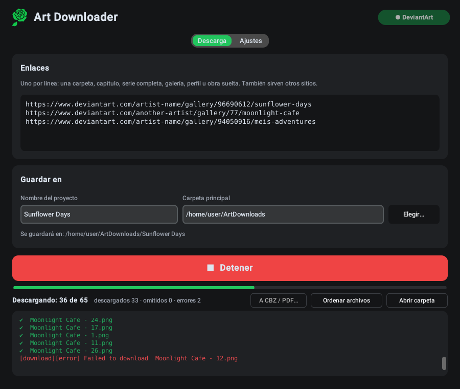

<p align="center"></p>

<h1 align="center">Art Downloader</h1>

<p align="center">
  <b>Descarga galerías y cómics completos de DeviantArt, en orden de lectura y sin mezclar archivos.</b><br>
  Windows · Linux · 6 idiomas
</p>

<p align="center">
  <a href="https://github.com/GreenClowns/Art-Downloader/releases/latest"><b>⬇ Descargar</b></a> ·
  <a href="#cómo-usarlo">Cómo usarlo</a> ·
  <a href="#preguntas-frecuentes">Preguntas</a>
</p>

<p align="center">
  <a href="README.md">English</a> · <a href="README.ru.md">Русский</a> · <a href="README.uk.md">Українська</a> · <b>Español</b> · <a href="README.ja.md">日本語</a> · <a href="README.zh.md">中文</a>
</p>

<p align="center">
  
</p>

Pega el enlace de una galería, una carpeta, un capítulo o una serie entera, pulsa **Descargar** y obtendrás una carpeta ordenada en tu ordenador: cada capítulo en su propia carpeta, cada página numerada en orden de lectura y todas las imágenes de las publicaciones con varias imágenes. Las obras 18+ se descargan con tu propia cuenta de DeviantArt. También sirven otros sitios compatibles con [gallery-dl](https://github.com/mikf/gallery-dl).

## Descargar

| Sistema | Archivo | Cómo abrirlo |
|---|---|---|
| **Windows 10/11** | `ArtDownloader-…-Setup.exe` | Ejecútalo y abre Art Downloader desde el menú Inicio |
| Windows sin instalar | `ArtDownloader-…-portable.zip` | Descomprímelo donde quieras y abre `ArtDownloader.exe` |
| **Linux** (Fedora, Ubuntu, Debian, Mint…) | `ArtDownloader-…-x86_64.AppImage` | Permite ejecutarlo una vez y luego haz doble clic |

Todos los archivos están en la página de [**Releases**](https://github.com/GreenClowns/Art-Downloader/releases/latest). Todo lo necesario va dentro: no hace falta instalar Python, usar la terminal ni nada más.

<details>
<summary><b>Windows: paso a paso</b></summary>

1. Descarga `ArtDownloader-…-Setup.exe` y ejecútalo. No hacen falta permisos de administrador.
2. Puede que Windows diga «Windows protegió su PC» porque la app no tiene firma digital: pulsa **Más información → Ejecutar de todas formas**.
3. Abre **Art Downloader** desde el menú Inicio.

</details>

<details>
<summary><b>Linux: paso a paso</b></summary>

1. Descarga `ArtDownloader-…-x86_64.AppImage` y déjalo donde se vaya a quedar (por ejemplo, una carpeta `Apps` en tu carpeta personal).
2. Permite que se ejecute (solo una vez): clic derecho en el archivo → **Propiedades** → activa **Ejecutable como programa** (en algunos sistemas, «Permitir ejecutar el archivo como un programa»).
3. Haz doble clic. La primera vez, la app te ofrece añadirse al menú de aplicaciones: di **Sí**. A partir de ahí, ábrela como cualquier otra app (tecla Super → «Art»).

Si más tarde mueves el archivo, ábrelo una vez desde el nuevo sitio y la entrada del menú se actualiza.

</details>

## Funciones

**Lo descarga todo, en orden**
- Una carpeta, un capítulo, una serie con subcarpetas, una galería, un perfil o una obra suelta: solo pega el enlace.
- **Todas las imágenes de una publicación**: las publicaciones de DeviantArt con varias imágenes se descargan completas, no solo la primera.
- **Orden de lectura**: cada carpeta del sitio se convierte en su propia carpeta y los archivos se numeran `001`, `002`, … El orden automático usa los números de los títulos («Chapter 2 Cover» → «Chapter 2 - Page 1» → … «Page 10»), así que las partes publicadas desordenadas o resubidas más tarde quedan en su sitio. Las obras sin números se ordenan por fecha. También puedes elegir fecha, orden de la galería o título.
- **Nada mezclado**: una obra que aparece en varios enlaces va a su carpeta más específica (su capítulo, no la galería entera del artista); las carpetas con varios capítulos se pueden separar en `Chapter 01`, `Chapter 02`, …

**Fiable**
- **Obras 18+** con tu cuenta: pulsa **Conectar DeviantArt** una vez (el inicio de sesión oficial de DeviantArt para apps). La app nunca guarda tu contraseña.
- Descargas en paralelo, reintento automático de lo que falla, **Detener** y continuar cuando quieras: lo ya descargado nunca se descarga dos veces y la numeración no se rompe.
- Una parte que el artista publique más tarde se coloca en su sitio en la siguiente descarga: los archivos se renumeran, no se descargan de nuevo.

**Cómodo**
- **A CBZ / PDF…**: un libro por capítulo. CBZ conserva las imágenes originales (para lectores de cómics) y PDF se abre en cualquier dispositivo.
- Una **notificación del sistema** cuando termina una descarga con la ventana en segundo plano.
- **Actualizaciones**: comprueba una vez al día; gallery-dl se actualiza con un clic (los cambios de DeviantArt rompen las versiones antiguas de los descargadores).
- Tema claro y oscuro; English, Русский, Українська, Español, 日本語 y 中文: el tema y el idioma siguen al sistema por defecto.

Lo que obtienes:

```
ArtDownloads/Sunflower Days/
├── Chapter 1 - Sunflower/
│   ├── 001 - Sunflower Days - Chapter 1 - Cover.png
│   ├── 002 - Sunflower Days - Chapter 1 - Part 1.png
│   └── …
├── Chapter 2 - Sunflower/
│   ├── 004 - Sunflower Days - Chapter 2 - Part 3.png
│   ├── 005 - Sunflower Days - Chapter 2 - Part 4.png
│   ├── 005-02 - Sunflower Days - Chapter 2 - Part 4.png   ← 2.ª imagen de la misma publicación
│   └── …
└── _Export/
    ├── Chapter 1 - Sunflower.cbz
    └── Chapter 2 - Sunflower.cbz
```

## Cómo usarlo

1. Pega los enlaces, uno por línea: galerías, carpetas, capítulos u obras de DeviantArt, o enlaces de otros sitios.
2. Escribe un **Nombre del proyecto**: todo se guarda en *Carpeta principal / Nombre del proyecto*.
3. Para obras 18+, pulsa **Conectar DeviantArt** (arriba a la derecha) una vez: se abre DeviantArt en el navegador; inicia sesión y pulsa **Authorize**.
4. Pulsa **⬇ Descargar**. La barra muestra «*k* de *N*»; puedes pulsar **Detener** en cualquier momento y seguir después.
5. Opcional: **A CBZ / PDF…** para crear libros y **Abrir carpeta** para ver el resultado.

Ajustes (segunda pestaña): formas de iniciar sesión, orden de los archivos, separar capítulos, descargas a la vez, notificaciones, actualizaciones, idioma y tema.

## Preguntas frecuentes

**Errores `403 Forbidden` en obras 18+.**
Pulsa **Conectar DeviantArt** y vuelve a descargar. Sin eso, DeviantArt solo entrega a las apps una versión borrosa.

**«Conectar DeviantArt» no termina.**
El navegador debe abrir una página de DeviantArt: inicia sesión ahí, pulsa **Authorize** y vuelve a la app. Si no se abrió el navegador, el enlace aparece en el registro: ábrelo a mano.

**Algunas obras no se descargaron.**
Normalmente es contenido de pago (suscripciones, Premium Gallery): solo se puede descargar si tu cuenta tiene acceso. El registro las enumera y sus números quedan libres, así ves qué falta.

**Los archivos están numerados desordenados.**
En **Ajustes → Orden de los archivos** elige **automático** (o **por título**) y pulsa **Ordenar archivos**: lo ya descargado se renumera y no se descarga nada de nuevo.

**Linux: hago doble clic en el AppImage y no pasa nada.**
Todavía no tiene permiso para ejecutarse: clic derecho → Propiedades → **Ejecutable como programa**. ¿Sigue sin abrirse? Ejecútalo desde una terminal (`./ArtDownloader-…AppImage`) y abre un issue con lo que muestre.

**Linux: la app desapareció del menú después de mover el archivo.**
Ábrelo una vez desde su nuevo sitio: la entrada del menú se actualiza sola.

**¿Dónde están los ajustes?**
Linux: `~/.config/art_downloader.json`. Windows: `%APPDATA%\ArtDownloader\settings.json`. La contraseña nunca se guarda. Más en [SECURITY.md](SECURITY.md).

## Desinstalar

- **Windows:** Configuración → Aplicaciones → Art Downloader → Desinstalar.
- **Linux (AppImage):** clic derecho en la app del menú → **Quitar del menú de aplicaciones** y luego borra el archivo `.AppImage`.
- **Linux (desde el código):** `bash install.sh uninstall`.

Tus descargas nunca se borran.

## Seguridad y privacidad

- La contraseña no se guarda; el acceso a DeviantArt usa el inicio de sesión oficial y puedes revocarlo cuando quieras.
- Además de los sitios de los que descargas, la app solo contacta con `pypi.org` y `api.github.com` una vez al día para buscar actualizaciones (se puede desactivar).
- Los datos de los sitios no pueden hacer que la app escriba fuera de tu carpeta de descargas; nunca sobrescribe otro archivo y avisa de las descargas que podrían ejecutar programas.
- Las versiones se compilan con GitHub Actions desde este repositorio, con herramientas fijadas y verificadas por suma de comprobación.

Detalles: [SECURITY.md](SECURITY.md).

## Para desarrolladores

Toda la app es un solo archivo, [`art_downloader.py`](art_downloader.py): Python con [CustomTkinter](https://github.com/TomSchimansky/CustomTkinter); las descargas las hace [gallery-dl](https://github.com/mikf/gallery-dl). Las traducciones están en el diccionario `TRANSLATIONS` del mismo archivo.

```bash
git clone https://github.com/GreenClowns/Art-Downloader.git
cd Art-Downloader
pip install -r requirements.txt
python3 art_downloader.py      # ejecutar desde el código
python3 -m pytest              # pruebas, sin internet
```

Para publicar una versión: **Releases → Draft a new release**, etiqueta `v1.2.3`, **Publish**: GitHub Actions lo compila todo y adjunta los archivos. Más sobre la estructura del repositorio en el [README en inglés](README.md#for-developers).

## Respeta a los artistas

Art Downloader está pensado para tu archivo personal. No vuelvas a subir obras ajenas sin permiso y apoya a los artistas que te gustan: síguelos, coméntales, compra su trabajo.

## Licencia

[MIT](LICENSE) © GreenClowns
