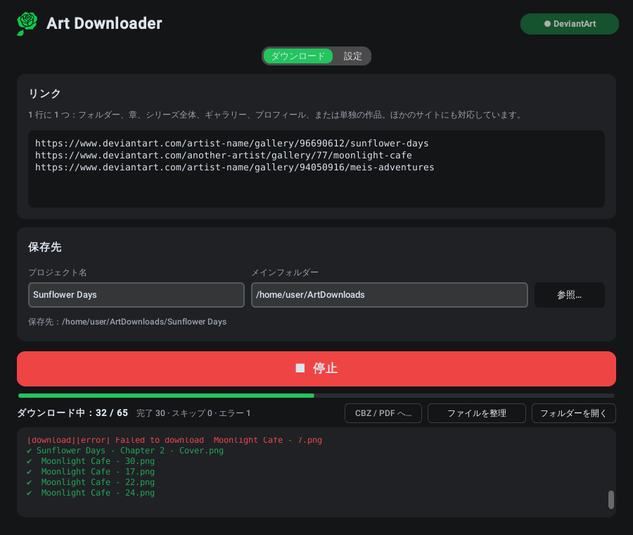

<p align="center"></p>

<h1 align="center">Art Downloader</h1>

<p align="center">
  <b>DeviantArt のギャラリーや漫画をまるごと、読む順番どおりに、ファイルを混ぜずにダウンロード。</b><br>
  Windows · Linux · 6 言語
</p>

<p align="center">
  <a href="https://github.com/GreenClowns/Art-Downloader/releases/latest"><b>⬇ ダウンロード</b></a> ·
  <a href="#使い方">使い方</a> ·
  <a href="#よくある質問">よくある質問</a>
</p>

<p align="center">
  <a href="README.md">English</a> · <a href="README.ru.md">Русский</a> · <a href="README.uk.md">Українська</a> · <a href="README.es.md">Español</a> · <b>日本語</b> · <a href="README.zh.md">中文</a>
</p>

<p align="center">
  
</p>

ギャラリー、フォルダー、章、またはシリーズ全体のリンクを貼り付けて **ダウンロード** を押すだけで、パソコンにきれいに整理されたフォルダーができます。章ごとにフォルダーが分かれ、すべてのページが読む順番に番号付けされ、複数の画像がある投稿は全画像が保存されます。18+ の作品は自分の DeviantArt アカウントでダウンロードできます。[gallery-dl](https://github.com/mikf/gallery-dl) が対応しているほかのサイトにも使えます。

## ダウンロード

| システム | ファイル | 起動方法 |
|---|---|---|
| **Windows 10/11** | `ArtDownloader-…-Setup.exe` | 実行したあと、スタートメニューから Art Downloader を開く |
| Windows（インストール不要） | `ArtDownloader-…-portable.zip` | 好きな場所に展開して `ArtDownloader.exe` を実行 |
| **Linux**（Fedora、Ubuntu、Debian、Mint など） | `ArtDownloader-…-x86_64.AppImage` | 一度だけ実行を許可して、あとはダブルクリック |

すべてのファイルは [**Releases**](https://github.com/GreenClowns/Art-Downloader/releases/latest) ページにあります。必要なものはすべて入っているので、Python やターミナルなど、ほかに何もインストールする必要はありません。

<details>
<summary><b>Windows：手順</b></summary>

1. `ArtDownloader-…-Setup.exe` をダウンロードして実行します。管理者権限は不要です。
2. アプリにデジタル署名がないため、「Windows によって PC が保護されました」と表示されることがあります。**詳細情報 → 実行** を押してください。
3. スタートメニューから **Art Downloader** を開きます。

</details>

<details>
<summary><b>Linux：手順</b></summary>

1. `ArtDownloader-…-x86_64.AppImage` をダウンロードし、ずっと置いておく場所（たとえばホームフォルダーの `Apps` フォルダー）に移します。
2. 実行を許可します（最初の 1 回だけ）：ファイルを右クリック → **プロパティ** → **プログラムとして実行可能** をオンにします（システムによっては「ファイルをプログラムとして実行することを許可する」）。
3. ダブルクリックで起動します。初回起動時にアプリケーションメニューへの追加を提案されるので **はい** を選んでください。以降はほかのアプリと同じように起動できます（Super キー →「Art」）。

あとでファイルを移動した場合は、新しい場所から一度起動すればメニューも更新されます。

</details>

## 主な機能

**すべてを順番どおりにダウンロード**
- フォルダー、章、サブフォルダーのあるシリーズ全体、ギャラリー、プロフィール、単独の作品 —— リンクを貼るだけです。
- **投稿内のすべての画像**：複数の画像を含む DeviantArt の投稿も、最初の 1 枚だけでなく全部ダウンロードします。
- **読む順番**：サイト上のフォルダーごとにフォルダーを作り、ファイルに `001`、`002` … と番号を付けます。自動モードではタイトル内の数字を使うので（「Chapter 2 Cover」→「Chapter 2 - Page 1」→ …「Page 10」）、順不同で投稿されたり、あとで再アップロードされたりしたパートも正しい位置に入ります。番号のない作品は日付順です。日付順、ギャラリーの順、タイトル順も選べます。
- **ごちゃまぜにならない**：複数のリンクに含まれる作品は、いちばん具体的なフォルダー（作者のギャラリー全体ではなく、その章）に入ります。複数の章が入ったフォルダーは `Chapter 01`、`Chapter 02` … に分けられます。

**安心**
- **18+ の作品** は自分のアカウントで：**DeviantArt に接続** を一度押すだけ（DeviantArt 公式のアプリ用ログイン）。パスワードは保存されません。
- 並列ダウンロード、失敗したファイルの自動再試行、いつでも **停止** して再開 —— ダウンロード済みのファイルを二重に取得することはなく、番号もずれません。
- 作者があとから公開したパートは、次回の実行で正しい位置に入ります。既存のファイルは再ダウンロードされず、番号だけが振り直されます。

**便利**
- **CBZ / PDF へ…**：章ごとに 1 冊。CBZ は元の画像をそのまま保存（漫画ビューアー向け）、PDF はどの端末でも開けます。
- ウィンドウが裏にあるときにダウンロードが終わると **デスクトップ通知** でお知らせ。
- **アップデート**：1 日 1 回確認し、gallery-dl はワンクリックで更新できます（DeviantArt の変更で古いダウンローダーは動かなくなることがあります）。
- ライト／ダークテーマ。English、Русский、Українська、Español、日本語、中文 —— テーマと言語は既定でシステムに合わせます。

できあがるフォルダー：

```
ArtDownloads/Sunflower Days/
├── Chapter 1 - Sunflower/
│   ├── 001 - Sunflower Days - Chapter 1 - Cover.png
│   ├── 002 - Sunflower Days - Chapter 1 - Part 1.png
│   └── …
├── Chapter 2 - Sunflower/
│   ├── 004 - Sunflower Days - Chapter 2 - Part 3.png
│   ├── 005 - Sunflower Days - Chapter 2 - Part 4.png
│   ├── 005-02 - Sunflower Days - Chapter 2 - Part 4.png   ← 同じ投稿の 2 枚目
│   └── …
└── _Export/
    ├── Chapter 1 - Sunflower.cbz
    └── Chapter 2 - Sunflower.cbz
```

## 使い方

1. リンクを 1 行に 1 つずつ貼り付けます。DeviantArt のギャラリー、フォルダー、章、単独の作品、またはほかのサイトのリンク。
2. **プロジェクト名** を入力します。すべて *メインフォルダー / プロジェクト名* に保存されます。
3. 18+ の作品の場合は、右上の **DeviantArt に接続** を一度押します。ブラウザーで DeviantArt が開くので、ログインして **Authorize** を押してください。
4. **⬇ ダウンロード** を押します。バーに「*k* / *N*」と表示されます。いつでも **停止** して、あとで続きから再開できます。
5. 必要に応じて：**CBZ / PDF へ…** で本を作成、**フォルダーを開く** で結果を確認。

設定（2 つ目のタブ）：ログイン方法、ファイルの順番、章の分割、同時ダウンロード数、通知、アップデート、言語とテーマ。

## よくある質問

**18+ の作品で `403 Forbidden` エラーが出る。**
**DeviantArt に接続** を押してから、もう一度ダウンロードしてください。接続しないと、DeviantArt はアプリにぼかした画像しか渡しません。

**「DeviantArt に接続」が完了しない。**
ブラウザーで DeviantArt のページが開くはずです。そこでログインして **Authorize** を押し、アプリに戻ってください。ブラウザーが開かない場合は、ログにリンクが表示されるので手動で開いてください。

**一部の作品がダウンロードされない。**
たいていは有料コンテンツ（サブスクリプション、Premium Gallery）で、自分のアカウントにアクセス権がある場合のみダウンロードできます。ログに一覧が出て、その番号は空いたままになるので、何が足りないかがわかります。

**ファイルの番号が順番どおりになっていない。**
**設定 → ファイルの順番** で **自動**（または **タイトル順**）を選び、**ファイルを整理** を押してください。ダウンロード済みのファイルの番号が振り直され、再ダウンロードはされません。

**Linux：AppImage をダブルクリックしても何も起きない。**
まだ実行が許可されていません。右クリック → プロパティ → **プログラムとして実行可能** をオンにしてください。それでも起動しない場合は、ターミナルから実行し（`./ArtDownloader-…AppImage`）、表示された内容を添えて issue を作成してください。

**Linux：ファイルを移動したらメニューから消えた。**
新しい場所から一度起動すれば、メニューの項目が自動で更新されます。

**設定はどこに保存される？**
Linux：`~/.config/art_downloader.json`。Windows：`%APPDATA%\ArtDownloader\settings.json`。パスワードは保存されません。詳しくは [SECURITY.md](SECURITY.md) を参照してください。

## アンインストール

- **Windows：** 設定 → アプリ → Art Downloader → アンインストール。
- **Linux（AppImage）：** メニューのアプリを右クリック → **アプリケーションメニューから削除**、そのあと `.AppImage` ファイルを削除。
- **Linux（ソースから）：** `bash install.sh uninstall`。

ダウンロードしたファイルは削除されません。

## セキュリティとプライバシー

- パスワードは保存されません。DeviantArt へのアクセスは公式のログインを使い、いつでも取り消せます。
- ダウンロード元のサイト以外では、アップデート確認のために 1 日 1 回 `pypi.org` と `api.github.com` にだけ接続します（オフにできます）。
- サイトのデータによってダウンロードフォルダーの外に書き込まれることはありません。別のファイルを上書きせず、プログラムを実行できるファイルがあれば警告します。
- リリースはこのリポジトリから GitHub Actions でビルドされ、ビルドツールはバージョン固定・チェックサム検証済みです。

詳しくは [SECURITY.md](SECURITY.md) をご覧ください。

## 開発者向け

アプリ全体は 1 つのファイル [`art_downloader.py`](art_downloader.py) です（Python ＋ [CustomTkinter](https://github.com/TomSchimansky/CustomTkinter)）。ダウンロードは [gallery-dl](https://github.com/mikf/gallery-dl) が行います。翻訳は同じファイル内の `TRANSLATIONS` 辞書にあります。

```bash
git clone https://github.com/GreenClowns/Art-Downloader.git
cd Art-Downloader
pip install -r requirements.txt
python3 art_downloader.py      # ソースから実行
python3 -m pytest              # テスト（インターネット不要）
```

バージョンを公開するには：**Releases → Draft a new release**、タグ `v1.2.3`、**Publish** —— GitHub Actions がすべてビルドしてファイルを添付します。リポジトリの構成は [英語版 README](README.md#for-developers) をご覧ください。

## 作者を大切に

Art Downloader は個人のアーカイブ用です。他人の作品を許可なく再投稿せず、好きなアーティストを応援しましょう —— フォロー、コメント、作品の購入で。

## ライセンス

[MIT](LICENSE) © GreenClowns
