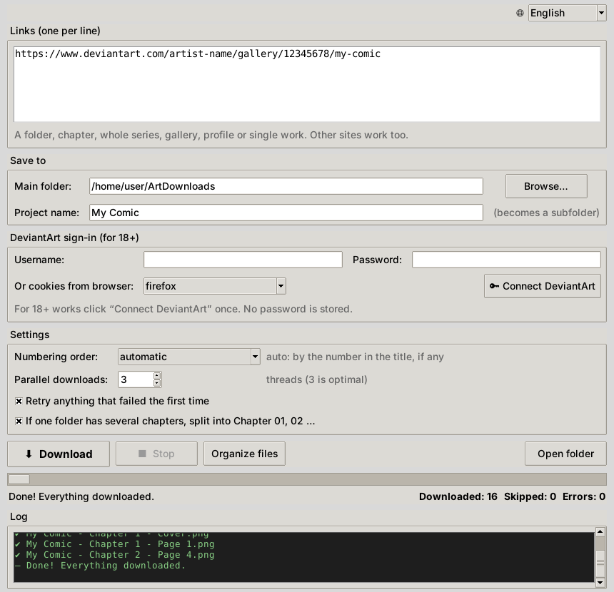

<p align="center"></p>

<h1 align="center">Art Downloader</h1>

**English** · [Русский](README.ru.md)

A simple desktop app for **Windows and Linux** for downloading art and comics from **DeviantArt** (and other sites supported by [gallery-dl](https://github.com/mikf/gallery-dl)) — whole folders at once, in reading order, with no mixed-up files.



## Features

- **Download everything at once**: a folder, chapter, whole series, gallery, profile or a single work — just paste the link.
- **Every image inside a work**: if a DeviantArt post has several images, you get all of them, not just the first one.
- **In order**: each gallery folder on the site gets its own folder on your computer, and files are numbered `001`, `002`, … By default the order is **automatic**: by the number in the title when the works have one (`Part 2` before `Part 10`, even if the artist posted them out of order), otherwise by publication date. You can also pick date, gallery order or title.
- **18+ works**: the “Connect DeviantArt” button gives the app access on behalf of your account, once (DeviantArt's official sign-in for apps). The app never stores your password.
- **Fast**: parallel downloads.
- **Reliable**: retries failed files automatically, resumes after Stop, never downloads the same file twice.
- **Chapters**: if one folder mixes several chapters, it can split them into `Chapter 01`, `Chapter 02`, …
- **Two languages**: English and Russian, switch with 🌐 in the top-right corner. Defaults to your system language.

Example result:

```
ArtDownloads/My Comic/
├── Chapter 1/
│   ├── 001 - My Comic - Chapter 1 - Cover.png
│   ├── 002 - My Comic - Chapter 1 - Page 1.png
│   └── …
└── Chapter 2/
    ├── 004 - My Comic - Chapter 2 - Page 4.png
    ├── 004-02 - My Comic - Chapter 2 - Page 4.png   ← second image in the same work
    └── …
```

## Installation

### Windows

1. Open [**Releases**](https://github.com/GreenClowns/Art-Downloader/releases/latest) and download `ArtDownloader-…-Setup.exe`.
2. Run it. No administrator rights are needed, and nothing else has to be installed — gallery-dl is built in.
3. Start **Art Downloader** from the Start menu.

> Windows may show “Windows protected your PC” because the app isn't code-signed. Click **More info → Run anyway**.

Prefer no installation? Download `ArtDownloader-…-portable.zip`, unpack it anywhere and run `ArtDownloader.exe`.

### Linux

Tested on Fedora; Ubuntu/Debian work too.

1. Click the green **Code → Download ZIP** button and unpack the archive.
2. Open a terminal in the unpacked folder and run once:
   ```bash
   bash install.sh
   ```
   The installer sets up everything it needs (`python3-tkinter`, `gallery-dl`) and may ask for your computer password.
3. Done: “Art Downloader” appears in your applications menu (press Super and start typing “Art”).

Or with git:

```bash
git clone https://github.com/GreenClowns/Art-Downloader.git
cd Art-Downloader
bash install.sh
```

## How to use

1. Paste links, one per line.
2. Enter a “Project name” — that's the folder everything is saved to.
3. For 18+ works, click **🔑 Connect DeviantArt** once: DeviantArt opens in your browser, click **Authorize**.
4. Click **⬇ Download**.

If a download gets interrupted, just click “Download” again: the app fetches only what's missing, and file numbers stay the same.

## FAQ

**`403 Forbidden` errors on 18+ works.**
Click “Connect DeviantArt” and download again. Without it, DeviantArt only gives apps a blurred version.

**Files are numbered out of order.**
The artist probably posted the parts out of order and the folder was numbered by publication date. Choose **Numbering order → automatic** (or **by title**) and click **Organize files**: everything already downloaded is renumbered, nothing is downloaded again.

**Some works still didn't download.**
Usually that's paid content (subscriptions, Premium Gallery). You can only download it if you have access to it on the site. The app lists these files at the end of the log.

**Where are the settings stored?**
Linux: `~/.config/art_downloader.json`. Windows: `%APPDATA%\ArtDownloader\settings.json`. Your password is never written there.

## Uninstall

**Windows:** Settings → Apps → Art Downloader → Uninstall.

**Linux:** right-click the app icon in the menu → **“Uninstall Art Downloader”**. Or:

```bash
bash install.sh uninstall
```

Your downloaded images are not deleted.

## For developers

The whole app is a single file, [`art_downloader.py`](art_downloader.py) (Python + Tkinter); downloading is done by [gallery-dl](https://github.com/mikf/gallery-dl). Logic tests (no internet needed):

```bash
python3 -m pytest
```

The Windows build is made by GitHub Actions ([`windows.yml`](.github/workflows/windows.yml)): PyInstaller bundles the app together with gallery-dl, Inno Setup makes the installer. Publishing a GitHub Release with a tag such as `v1.0.0` builds it and attaches the files. Icons are generated from the logo with `python3 tools/make_icons.py`.

## Respect the artists

This app is meant for your personal archive. Don't re-upload other people's work without their permission, and support the artists whose work you enjoy.

## License

[MIT](LICENSE)
