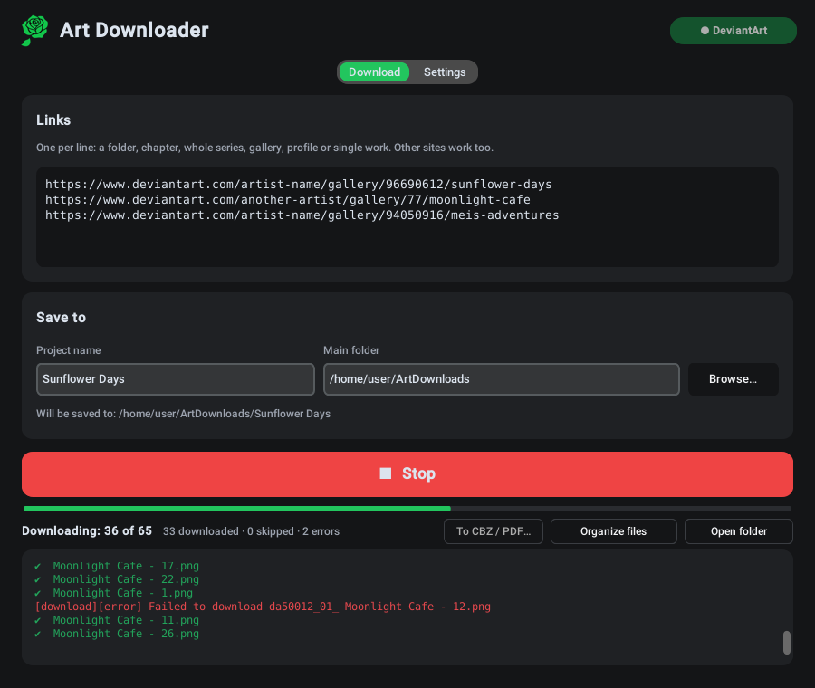

<p align="center"></p>

<h1 align="center">Art Downloader</h1>

<p align="center">
  <b>Download whole art galleries and comics from DeviantArt — in reading order, with nothing mixed up.</b><br>
  Windows · Linux · English / Русский
</p>

<p align="center">
  <a href="https://github.com/GreenClowns/Art-Downloader/releases/latest"><b>⬇ Download</b></a> ·
  <a href="#how-to-use">How to use</a> ·
  <a href="#faq">FAQ</a> ·
  <a href="README.ru.md">Русский</a>
</p>

<p align="center">
  
</p>

Paste a link to a gallery, a folder, a chapter or a whole series, press **Download** — and get a tidy folder on your computer: every chapter in its own folder, every page numbered in reading order, every image of multi-image posts included. Works with 18+ works through your own DeviantArt account, and with any other site supported by [gallery-dl](https://github.com/mikf/gallery-dl).

## Download

| System | File | How to start |
|---|---|---|
| **Windows 10/11** | `ArtDownloader-…-Setup.exe` | Run it, then open Art Downloader from the Start menu |
| Windows, no install | `ArtDownloader-…-portable.zip` | Unpack anywhere, run `ArtDownloader.exe` |
| **Linux** (Fedora, Ubuntu, Debian, Mint…) | `ArtDownloader-…-x86_64.AppImage` | Allow it to run once, then double-click |

All files are on the [**Releases**](https://github.com/GreenClowns/Art-Downloader/releases/latest) page. Everything the app needs is inside — no Python, no terminal, nothing else to install.

<details>
<summary><b>Windows: step by step</b></summary>

1. Download `ArtDownloader-…-Setup.exe` and run it. No administrator rights are needed.
2. Windows may say “Windows protected your PC” because the app isn't code-signed: click **More info → Run anyway**.
3. Start **Art Downloader** from the Start menu.

</details>

<details>
<summary><b>Linux: step by step</b></summary>

1. Download `ArtDownloader-…-x86_64.AppImage` and put it where it will stay (for example a folder `Apps` in your home folder).
2. Allow it to run — once: right-click the file → **Properties** → turn on **Executable as Program** (on some systems “Allow executing file as program”).
3. Double-click it. On the first start the app offers to add itself to your applications menu — say **Yes**. From then on, start it like any other app (Super key → “Art”).

If you move the file later, start it once from the new place and the menu entry follows.

</details>

## Features

**Downloads everything, in order**
- A folder, a chapter, a whole series with sub-folders, a gallery, a profile or a single work — just paste the link.
- **All images of a post**: DeviantArt posts with several images are downloaded completely, not only the first picture.
- **Reading order**: each folder on the site becomes its own folder, files are numbered `001`, `002`, … The automatic order uses the numbers in titles (“Chapter 2 Cover” → “Chapter 2 - Page 1” → … “Page 10”), so parts posted out of order or re-uploaded later still land in the right place. Works without numbers are ordered by date. You can also choose date, gallery order or title.
- **Nothing mixed up**: a work that appears in several links goes to its most specific folder (its chapter, not the artist's whole gallery); folders with several chapters can be split into `Chapter 01`, `Chapter 02`, …

**Reliable**
- **18+ works** through your own account: click **Connect DeviantArt** once (DeviantArt's official sign-in for apps). The app never stores your password.
- Parallel downloads, automatic retry of failed files, **Stop** and resume at any moment — already downloaded files are never downloaded twice, and numbering doesn't break.
- A part the artist publishes later is inserted in its place on the next run; existing files are renumbered, not re-downloaded.

**Convenient**
- **To CBZ / PDF…**: one book per chapter. CBZ keeps the original images (for comic readers), PDF opens on any device.
- A **desktop notification** when a download finishes while the window is in the background.
- **Updates**: checks once a day; gallery-dl can be updated with one click (DeviantArt changes break old versions of downloaders).
- Light and dark themes, English and Russian — both follow your system by default.

What you get:

```
ArtDownloads/Sunflower Days/
├── Chapter 1 - Sunflower/
│   ├── 001 - Sunflower Days - Chapter 1 - Cover.png
│   ├── 002 - Sunflower Days - Chapter 1 - Part 1.png
│   └── …
├── Chapter 2 - Sunflower/
│   ├── 004 - Sunflower Days - Chapter 2 - Part 3.png
│   ├── 005 - Sunflower Days - Chapter 2 - Part 4.png
│   ├── 005-02 - Sunflower Days - Chapter 2 - Part 4.png   ← 2nd image of the same post
│   └── …
└── _Export/
    ├── Chapter 1 - Sunflower.cbz
    └── Chapter 2 - Sunflower.cbz
```

## How to use

1. Paste links, one per line — DeviantArt galleries, folders, chapters, single works, or links from other sites.
2. Enter a **Project name**: everything is saved to *Main folder / Project name*.
3. For 18+ works click **Connect DeviantArt** (top right) once: DeviantArt opens in your browser — sign in and click **Authorize**.
4. Click **⬇ Download**. The progress bar shows “*k* of *N*”; you can click **Stop** at any time and continue later.
5. Optional: **To CBZ / PDF…** to make books, **Open folder** to see the result.

Settings (second tab): sign-in options, file order, chapter splitting, parallel downloads, notifications, updates, language and theme.

## FAQ

**`403 Forbidden` errors on 18+ works.**
Click **Connect DeviantArt** and download again. Without it DeviantArt gives apps only a blurred version.

**“Connect DeviantArt” doesn't finish.**
The browser must open a DeviantArt page; sign in there and click **Authorize**, then return to the app. If no browser opened, the log shows the link — open it manually.

**Some works didn't download.**
Usually paid content (subscriptions, Premium Gallery) — it can only be downloaded if your account has access to it. The log lists these files; their numbers stay free, so you can see what's missing.

**Files are numbered out of order.**
In **Settings → File order** choose **automatic** (or **by title**) and click **Organize files** — already downloaded files are renumbered, nothing is downloaded again.

**Linux: double-clicking the AppImage does nothing.**
It isn't allowed to run yet: right-click → Properties → **Executable as Program**. Still nothing? Run it from a terminal (`./ArtDownloader-…AppImage`) and open an issue with what it prints.

**Linux: the app disappeared from the menu after I moved the file.**
Start the file once from its new place — the menu entry is updated automatically.

**Where are the settings?**
Linux: `~/.config/art_downloader.json`. Windows: `%APPDATA%\ArtDownloader\settings.json`. The password is never saved. More in [SECURITY.md](SECURITY.md).

## Uninstall

- **Windows:** Settings → Apps → Art Downloader → Uninstall.
- **Linux (AppImage):** right-click the app in the menu → **Remove from the applications menu**, then delete the `.AppImage` file.
- **Linux (from source):** right-click the app in the menu → **Uninstall Art Downloader**, or `bash install.sh uninstall`.

Your downloaded files are never deleted.

## Security and privacy

- The password is never stored; DeviantArt access uses the official sign-in, and you can revoke it any time.
- Besides the sites you download from, the app only contacts `pypi.org` and `api.github.com` once a day to check for updates (can be switched off).
- Website data can't make the app write outside your download folder; it never overwrites a different file and warns about downloads that could run programs.
- Releases are built by GitHub Actions from this repository with pinned, checksum-verified tools.

Details: [SECURITY.md](SECURITY.md).

## For developers

The whole app is one file, [`art_downloader.py`](art_downloader.py) — Python with [CustomTkinter](https://github.com/TomSchimansky/CustomTkinter); downloading is done by [gallery-dl](https://github.com/mikf/gallery-dl).

```bash
git clone https://github.com/GreenClowns/Art-Downloader.git
cd Art-Downloader
pip install -r requirements.txt
python3 art_downloader.py      # run from source
python3 -m pytest              # tests, no internet needed
bash install.sh                # Linux: install from source with a menu entry
```

| Path | What it is |
|---|---|
| `art_downloader.py` | the app |
| `tests/` | logic tests (ordering, folders, export, security, …) |
| `linux/build_appimage.sh` | builds the Linux AppImage |
| `windows/installer.iss` | Inno Setup script for the Windows installer |
| `.github/workflows/build.yml` | builds and tests the `.exe`, installer and AppImage; attaches them to releases |
| `tools/make_icons.py` | makes the icons from `assets/logo.png` |
| `install.sh` | Linux install from source |

To publish a version: **Releases → Draft a new release**, tag `v1.2.3`, **Publish** — GitHub Actions builds everything and attaches the files.

## Respect the artists

Art Downloader is meant for your personal archive. Don't re-upload other people's work without their permission, and support the artists you enjoy — follow them, comment, buy their work.

## License

[MIT](LICENSE) © GreenClowns
