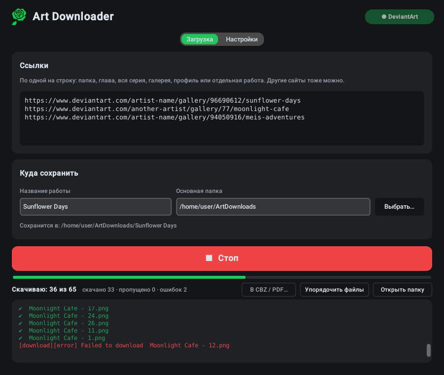

<p align="center"></p>

<h1 align="center">Art Downloader</h1>

<p align="center">
  <b>Скачивай целые галереи и комиксы с DeviantArt — по порядку чтения и без путаницы в файлах.</b><br>
  Windows · Linux · 6 языков
</p>

<p align="center">
  <a href="https://github.com/GreenClowns/Art-Downloader/releases/latest"><b>⬇ Скачать</b></a> ·
  <a href="#как-пользоваться">Как пользоваться</a> ·
  <a href="#частые-вопросы">Вопросы</a>
</p>

<p align="center">
  <a href="README.md">English</a> · <b>Русский</b> · <a href="README.uk.md">Українська</a> · <a href="README.es.md">Español</a> · <a href="README.ja.md">日本語</a> · <a href="README.zh.md">中文</a>
</p>

<p align="center">
  
</p>

Вставь ссылку на галерею, папку, главу или целую серию, нажми **Скачать** — и получи аккуратную папку на компьютере: у каждой главы своя папка, все страницы пронумерованы по порядку чтения, из постов с несколькими картинками скачиваются все. Работы 18+ — через твой собственный аккаунт DeviantArt. Подходят и другие сайты, которые поддерживает [gallery-dl](https://github.com/mikf/gallery-dl).

## Скачать

| Система | Файл | Как запустить |
|---|---|---|
| **Windows 10/11** | `ArtDownloader-…-Setup.exe` | Запусти, потом открывай Art Downloader из меню «Пуск» |
| Windows без установки | `ArtDownloader-…-portable.zip` | Распакуй куда угодно, запусти `ArtDownloader.exe` |
| **Linux** (Fedora, Ubuntu, Debian, Mint…) | `ArtDownloader-…-x86_64.AppImage` | Один раз разреши запуск, дальше — двойной щелчок |

Все файлы — на странице [**Releases**](https://github.com/GreenClowns/Art-Downloader/releases/latest). Всё нужное уже внутри: ни Python, ни терминал, ни что-либо ещё ставить не надо.

<details>
<summary><b>Windows: по шагам</b></summary>

1. Скачай `ArtDownloader-…-Setup.exe` и запусти. Права администратора не нужны.
2. Windows может написать «Система Windows защитила ваш компьютер» — у программы нет цифровой подписи. Нажми **Подробнее → Выполнить в любом случае**.
3. Открывай **Art Downloader** из меню «Пуск».

</details>

<details>
<summary><b>Linux: по шагам</b></summary>

1. Скачай `ArtDownloader-…-x86_64.AppImage` и положи туда, где он будет лежать постоянно (например, в папку `Apps` в домашней папке).
2. Разреши запуск — один раз: правый клик по файлу → **Свойства** → включи **«Исполняемый как программа»** (в некоторых системах — «Разрешить выполнение файла как программы»).
3. Запусти двойным щелчком. При первом запуске программа предложит добавить себя в меню приложений — нажми **Да**. Дальше запускай её как обычную программу (клавиша Super → «Art»).

Если потом переместишь файл — запусти его один раз с нового места, и пункт в меню обновится.

</details>

## Возможности

**Скачивает всё и по порядку**
- Папка, глава, целая серия с подпапками, галерея, профиль или отдельная работа — просто вставь ссылку.
- **Все картинки поста**: посты DeviantArt с несколькими изображениями скачиваются полностью, а не только первая картинка.
- **Порядок чтения**: каждая папка на сайте становится своей папкой, файлы пронумерованы `001`, `002`, … Автоматический порядок опирается на числа в названиях («Chapter 2 Cover» → «Chapter 2 - Page 1» → … «Page 10»), поэтому части, выложенные вперемешку или перезалитые позже, всё равно встают на свои места. Работы без номеров идут по дате. Можно выбрать и вручную: по дате, как в галерее или по названию.
- **Без путаницы**: работа, которая попала в несколько ссылок, оказывается в самой подходящей папке (в своей главе, а не в общей галерее автора); папки с несколькими главами можно разнести по `Chapter 01`, `Chapter 02`, …

**Надёжно**
- **Работы 18+** через твой аккаунт: один раз нажми **Подключить DeviantArt** (официальный вход DeviantArt для программ). Пароль программа не хранит.
- Скачивание в несколько потоков, автоповтор неудачных файлов, **Стоп** и продолжение в любой момент — уже скачанное повторно не качается, нумерация не сбивается.
- Часть, которую автор выложит позже, при следующем запуске встанет на своё место: файлы перенумеруются, а не скачаются заново.

**Удобно**
- **В CBZ / PDF…**: по книге на главу. CBZ сохраняет оригинальные картинки (для читалок комиксов), PDF открывается на любом устройстве.
- **Системное уведомление**, когда скачивание закончилось, а окно было в фоне.
- **Обновления**: проверка раз в день; gallery-dl обновляется одной кнопкой (DeviantArt меняет сайт, и старые версии загрузчиков перестают работать).
- Светлая и тёмная тема; English, Русский, Українська, Español, 日本語 и 中文 — тема и язык по умолчанию как в системе.

Что получается:

```
ArtDownloads/Sunflower Days/
├── Chapter 1 - Sunflower/
│   ├── 001 - Sunflower Days - Chapter 1 - Cover.png
│   ├── 002 - Sunflower Days - Chapter 1 - Part 1.png
│   └── …
├── Chapter 2 - Sunflower/
│   ├── 004 - Sunflower Days - Chapter 2 - Part 3.png
│   ├── 005 - Sunflower Days - Chapter 2 - Part 4.png
│   ├── 005-02 - Sunflower Days - Chapter 2 - Part 4.png   ← 2-я картинка того же поста
│   └── …
└── _Export/
    ├── Chapter 1 - Sunflower.cbz
    └── Chapter 2 - Sunflower.cbz
```

## Как пользоваться

1. Вставь ссылки, по одной на строку: галереи, папки, главы, отдельные работы DeviantArt или ссылки с других сайтов.
2. Впиши **Название работы**: всё сохранится в *Основная папка / Название работы*.
3. Для работ 18+ один раз нажми **Подключить DeviantArt** (справа вверху): в браузере откроется DeviantArt — войди и нажми **Authorize**.
4. Нажми **⬇ Скачать**. Полоска показывает «*k* из *N*»; в любой момент можно нажать **Стоп** и продолжить потом.
5. По желанию: **В CBZ / PDF…** — сделать книги, **Открыть папку** — посмотреть результат.

Настройки (вторая вкладка): способы входа, порядок файлов, разбивка по главам, число потоков, уведомления, обновления, язык и тема.

## Частые вопросы

**Ошибка `403 Forbidden` на работах 18+.**
Нажми **Подключить DeviantArt** и скачай ещё раз. Без этого DeviantArt отдаёт программам только размытую версию.

**«Подключить DeviantArt» не завершается.**
В браузере должна открыться страница DeviantArt: войди и нажми **Authorize**, потом вернись в программу. Если браузер не открылся, ссылка есть в журнале — открой её вручную.

**Некоторые работы не скачались.**
Обычно это платный контент (подписка, Premium Gallery) — скачать его можно, только если у твоего аккаунта есть к нему доступ. Такие файлы перечислены в журнале, а их номера остаются свободными — видно, чего не хватает.

**Файлы пронумерованы не по порядку.**
В **Настройки → Порядок файлов** выбери **автоматически** (или **по названию**) и нажми **Упорядочить файлы** — уже скачанное перенумеруется, заново ничего не качается.

**Linux: двойной щелчок по AppImage ничего не делает.**
Файлу ещё не разрешён запуск: правый клик → Свойства → **«Исполняемый как программа»**. Всё равно не запускается? Запусти из терминала (`./ArtDownloader-…AppImage`) и открой issue с тем, что он напишет.

**Linux: программа пропала из меню после того, как я переместил файл.**
Запусти файл один раз с нового места — пункт в меню обновится сам.

**Где хранятся настройки?**
Linux: `~/.config/art_downloader.json`. Windows: `%APPDATA%\ArtDownloader\settings.json`. Пароль не сохраняется никогда. Подробнее — в [SECURITY.md](SECURITY.md#безопасность).

## Удаление

- **Windows:** Параметры → Приложения → Art Downloader → Удалить.
- **Linux (AppImage):** правый клик по программе в меню → **«Убрать из меню приложений»**, потом удали файл `.AppImage`.
- **Linux (из исходников):** правый клик по программе в меню → **«Удалить Art Downloader»** или `bash install.sh удалить`.

Скачанные файлы при этом не удаляются.

## Безопасность и приватность

- Пароль не хранится; доступ к DeviantArt — через официальный вход, его можно отозвать в любой момент.
- Кроме сайтов, с которых ты качаешь, программа раз в день обращается только к `pypi.org` и `api.github.com`, чтобы проверить обновления (можно отключить).
- Данные с сайтов не могут заставить программу писать за пределы папки загрузки; она не перезаписывает чужие файлы и предупреждает о скачанных файлах, которые могут запускать программы.
- Выпуски собирает GitHub Actions из этого репозитория, инструменты сборки закреплены и проверяются по контрольным суммам.

Подробности — в [SECURITY.md](SECURITY.md#безопасность).

## Для разработчиков

Вся программа — один файл [`art_downloader.py`](art_downloader.py): Python и [CustomTkinter](https://github.com/TomSchimansky/CustomTkinter); скачивание выполняет [gallery-dl](https://github.com/mikf/gallery-dl). Русские и английские тексты написаны прямо в коде, украинские, испанские, японские и китайские — в словаре `TRANSLATIONS` в том же файле (тест следит, чтобы ничего не пропало).

```bash
git clone https://github.com/GreenClowns/Art-Downloader.git
cd Art-Downloader
pip install -r requirements.txt
python3 art_downloader.py      # запуск из исходников
python3 -m pytest              # тесты, интернет не нужен
bash install.sh                # Linux: установка из исходников со значком в меню
```

| Путь | Что это |
|---|---|
| `art_downloader.py` | сама программа |
| `tests/` | тесты логики (порядок, папки, экспорт, безопасность, …) |
| `linux/build_appimage.sh` | сборка AppImage для Linux |
| `windows/installer.iss` | сценарий Inno Setup для установщика Windows |
| `.github/workflows/build.yml` | собирает и проверяет `.exe`, установщик и AppImage, прикладывает их к выпускам |
| `tools/make_icons.py` | делает значки из `assets/logo.png` |
| `install.sh` | установка на Linux из исходников |

Чтобы выпустить версию: **Releases → Draft a new release**, метка `v1.2.3`, **Publish** — GitHub Actions всё соберёт и приложит файлы.

## Уважай авторов

Art Downloader сделан для личного архива. Не выкладывай чужие работы повторно без согласия автора и поддерживай художников, которые тебе нравятся: подписывайся, комментируй, покупай их работы.

## Лицензия

[MIT](LICENSE) © GreenClowns
