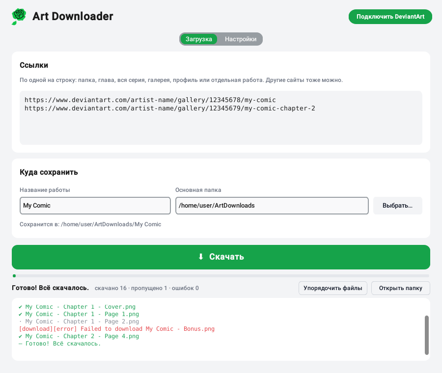

<p align="center"></p>

<h1 align="center">Art Downloader</h1>

[English](README.md) · **Русский**

Простая программа с окном для **Windows и Linux**, чтобы скачивать арты и комиксы с **DeviantArt** (и других сайтов, которые поддерживает [gallery-dl](https://github.com/mikf/gallery-dl)) — целыми папками, по порядку и без путаницы в файлах.

<p align="center">
  
  
</p>

## Что умеет

- **Скачивает целиком**: папку, главу, всю серию, галерею, профиль или отдельную работу — просто вставь ссылку.
- **Все картинки внутри работы**: если в одном посте DeviantArt несколько изображений, скачаются все, а не только первое.
- **По порядку**: у каждой папки с сайта — своя папка на компьютере, файлы пронумерованы `001`, `002`, … По умолчанию порядок **автоматический**: по номеру в названии, если он есть у работ (`Part 2` раньше `Part 10`, даже если автор выкладывал их вперемешку), иначе по дате публикации. Можно выбрать и вручную: по дате, как в галерее или по названию.
- **Работы 18+**: кнопка «Подключить DeviantArt» один раз даёт программе доступ от имени твоего аккаунта (официальный вход DeviantArt для программ). Пароль программа не хранит.
- **Быстро**: скачивание в несколько потоков.
- **Надёжно**: сама повторяет то, что не скачалось; после «Стоп» продолжает с места; уже скачанное не качает повторно.
- **Главы**: если в одной папке перемешаны главы, раскладывает их по `Chapter 01`, `Chapter 02`, …
- **Читать где угодно**: кнопка **В CBZ / PDF…** делает по книге на главу — CBZ сохраняет картинки без потерь, PDF открывается на любом устройстве.
- **Уведомления**: системное уведомление, когда скачивание закончилось, а окно было в фоне.
- **Не ломается со временем**: раз в день проверяет обновления; на Linux gallery-dl обновляется одной кнопкой в настройках (DeviantArt меняет сайт, и старые версии перестают работать).
- **Простой современный вид**: светлая и тёмная тема (по умолчанию — как в системе), одна большая кнопка «Скачать/Стоп», всё остальное — на вкладке **Настройки**.
- **Два языка**: русский и английский (Настройки → Внешний вид). По умолчанию — язык системы.

Пример результата:

```
ArtDownloads/My Comic/
├── Chapter 1/
│   ├── 001 - My Comic - Chapter 1 - Cover.png
│   ├── 002 - My Comic - Chapter 1 - Page 1.png
│   └── …
└── Chapter 2/
    ├── 004 - My Comic - Chapter 2 - Page 4.png
    ├── 004-02 - My Comic - Chapter 2 - Page 4.png   ← вторая картинка в той же работе
    └── …
```

## Установка

### Windows

1. Открой [**Releases**](https://github.com/GreenClowns/Art-Downloader/releases/latest) и скачай `ArtDownloader-…-Setup.exe`.
2. Запусти его. Права администратора не нужны, и ничего дополнительно ставить не надо — gallery-dl уже встроен.
3. Открывай **Art Downloader** из меню «Пуск».

> Windows может показать «Система Windows защитила ваш компьютер», потому что у программы нет цифровой подписи. Нажми **Подробнее → Выполнить в любом случае**.

Не хочешь устанавливать? Скачай `ArtDownloader-…-portable.zip`, распакуй куда угодно и запусти `ArtDownloader.exe`.

### Linux

Проверено на Fedora; Ubuntu/Debian тоже подходят.

1. Нажми зелёную кнопку **Code → Download ZIP** и распакуй архив.
2. Открой терминал в распакованной папке и выполни один раз:
   ```bash
   bash install.sh
   ```
   Установщик сам поставит всё нужное: `python3-tkinter` из системы (может спросить пароль от компьютера) и отдельное окружение Python программы с её библиотеками (нужен интернет).
3. Готово: «Art Downloader» появится в меню приложений (клавиша Super → начни вводить «Art»).

Или через git:

```bash
git clone https://github.com/GreenClowns/Art-Downloader.git
cd Art-Downloader
bash install.sh
```

## Как пользоваться

1. Вставь ссылки — по одной на строку.
2. Впиши «Название работы» — это будет папка, куда всё сохранится.
3. Для работ 18+ один раз нажми **Подключить DeviantArt** (справа вверху): в браузере откроется DeviantArt, нажми **Authorize**.
4. Нажми **⬇ Скачать**.

Если скачивание прервалось — просто нажми «Скачать» ещё раз: программа докачает только недостающее, номера файлов не собьются.

## Частые вопросы

**Ошибка `403 Forbidden` на работах 18+.**
Нажми «Подключить DeviantArt» и скачай ещё раз. Без этого DeviantArt отдаёт программам только размытую версию.

**Файлы пронумерованы не по порядку.**
Скорее всего, автор выкладывал части вперемешку, а папка была пронумерована по дате публикации. В **Настройки → Порядок файлов** выбери **автоматически** (или **по названию**) и нажми **Упорядочить файлы**: всё уже скачанное перенумеруется, заново ничего не качается.

**Некоторые работы так и не скачались.**
Обычно это платный контент (подписка, Premium Gallery). Его можно скачать, только если у тебя есть доступ к нему на сайте. Список таких файлов программа выводит в конце журнала.

**Где хранятся настройки?**
Linux: `~/.config/art_downloader.json`. Windows: `%APPDATA%\ArtDownloader\settings.json`. Пароль туда не записывается.

## Удаление

**Windows:** Параметры → Приложения → Art Downloader → Удалить.

**Linux:** правый клик по значку в меню → **«Удалить Art Downloader»**. Или:

```bash
bash install.sh удалить
```

Скачанные картинки при этом не удаляются.

## Для разработчиков

Вся программа — один файл [`art_downloader.py`](art_downloader.py) (Python + [CustomTkinter](https://github.com/TomSchimansky/CustomTkinter)), скачивание выполняет [gallery-dl](https://github.com/mikf/gallery-dl). Запуск из исходников и тесты логики (без интернета):

```bash
pip install -r requirements.txt
python3 art_downloader.py
python3 -m pytest
```

Версию для Windows собирает GitHub Actions ([`windows.yml`](.github/workflows/windows.yml)): PyInstaller упаковывает программу вместе с gallery-dl, Inno Setup делает установщик. Выпуск (Release) с меткой вроде `v1.0.0` автоматически собирается, и файлы прикрепляются к нему. Значки делаются из логотипа командой `python3 tools/make_icons.py`.

## Безопасность

Что хранит программа, как она защищается и как отозвать доступ к DeviantArt — в [SECURITY.md](SECURITY.md#безопасность).

## Уважай авторов

Программа сделана для личного архива. Не выкладывай чужие работы повторно без согласия автора и поддерживай художников, если тебе нравится их творчество.

## Лицензия

[MIT](LICENSE)
