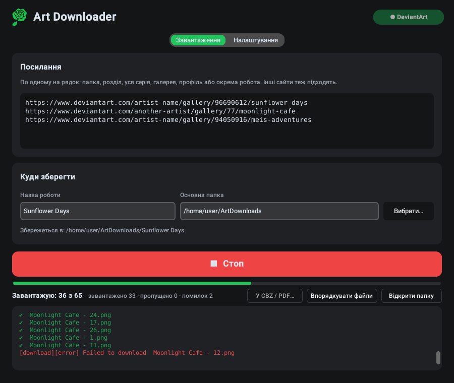

<p align="center"></p>

<h1 align="center">Art Downloader</h1>

<p align="center">
  <b>Завантажуй цілі галереї та комікси з DeviantArt — у порядку читання і без плутанини у файлах.</b><br>
  Windows · Linux · 6 мов
</p>

<p align="center">
  <a href="https://github.com/GreenClowns/Art-Downloader/releases/latest"><b>⬇ Завантажити</b></a> ·
  <a href="#як-користуватися">Як користуватися</a> ·
  <a href="#часті-запитання">Запитання</a>
</p>

<p align="center">
  <a href="README.md">English</a> · <a href="README.ru.md">Русский</a> · <b>Українська</b> · <a href="README.es.md">Español</a> · <a href="README.ja.md">日本語</a> · <a href="README.zh.md">中文</a>
</p>

<p align="center">
  
</p>

Встав посилання на галерею, папку, розділ або цілу серію, натисни **Завантажити** — і отримай охайну папку на комп'ютері: у кожного розділу своя папка, усі сторінки пронумеровані в порядку читання, з постів із кількома зображеннями завантажуються всі. Роботи 18+ — через твій власний акаунт DeviantArt. Підходять і інші сайти, які підтримує [gallery-dl](https://github.com/mikf/gallery-dl).

## Завантажити

| Система | Файл | Як запустити |
|---|---|---|
| **Windows 10/11** | `ArtDownloader-…-Setup.exe` | Запусти, потім відкривай Art Downloader з меню «Пуск» |
| Windows без встановлення | `ArtDownloader-…-portable.zip` | Розпакуй будь-куди, запусти `ArtDownloader.exe` |
| **Linux** (Fedora, Ubuntu, Debian, Mint…) | `ArtDownloader-…-x86_64.AppImage` | Один раз дозволь запуск, далі — подвійний клік |

Усі файли — на сторінці [**Releases**](https://github.com/GreenClowns/Art-Downloader/releases/latest). Усе потрібне вже всередині: ні Python, ні термінал, ні щось інше встановлювати не треба.

<details>
<summary><b>Windows: крок за кроком</b></summary>

1. Завантаж `ArtDownloader-…-Setup.exe` і запусти. Права адміністратора не потрібні.
2. Windows може написати «Windows захистила ваш ПК» — у програми немає цифрового підпису. Натисни **Докладніше → Усе одно запустити**.
3. Відкривай **Art Downloader** з меню «Пуск».

</details>

<details>
<summary><b>Linux: крок за кроком</b></summary>

1. Завантаж `ArtDownloader-…-x86_64.AppImage` і поклади туди, де він лежатиме постійно (наприклад, у папку `Apps` у домашній папці).
2. Дозволь запуск — один раз: правий клік по файлу → **Властивості** → увімкни **«Виконуваний як програма»** (у деяких системах — «Дозволити виконання файлу як програми»).
3. Запусти подвійним клацанням. Під час першого запуску програма запропонує додати себе в меню застосунків — натисни **Так**. Далі запускай її як звичайну програму (клавіша Super → «Art»).

Якщо потім перемістиш файл — запусти його один раз з нового місця, і пункт у меню оновиться.

</details>

## Можливості

**Завантажує все і по порядку**
- Папка, розділ, ціла серія з підпапками, галерея, профіль або окрема робота — просто встав посилання.
- **Усі зображення поста**: пости DeviantArt із кількома зображеннями завантажуються повністю, а не лише перша картинка.
- **Порядок читання**: кожна папка на сайті стає своєю папкою, файли пронумеровані `001`, `002`, … Автоматичний порядок спирається на числа в назвах («Chapter 2 Cover» → «Chapter 2 - Page 1» → … «Page 10»), тож частини, викладені впереміш або перезалиті пізніше, все одно стають на свої місця. Роботи без номерів ідуть за датою. Можна вибрати й вручну: за датою, як у галереї або за назвою.
- **Без плутанини**: робота, яка потрапила в кілька посилань, опиняється в найвідповіднішій папці (у своєму розділі, а не в загальній галереї автора); папки з кількома розділами можна розкласти по `Chapter 01`, `Chapter 02`, …

**Надійно**
- **Роботи 18+** через твій акаунт: один раз натисни **Підключити DeviantArt** (офіційний вхід DeviantArt для програм). Пароль програма не зберігає.
- Завантаження в кілька потоків, автоповтор невдалих файлів, **Стоп** і продовження будь-коли — уже завантажене повторно не качається, нумерація не збивається.
- Частина, яку автор викладе пізніше, під час наступного запуску стане на своє місце: файли перенумеруються, а не завантажаться заново.

**Зручно**
- **У CBZ / PDF…**: одна книга на розділ. CBZ зберігає оригінальні зображення (для читалок коміксів), PDF відкривається на будь-якому пристрої.
- **Системне сповіщення**, коли завантаження завершилося, а вікно було у фоні.
- **Оновлення**: перевірка раз на день; gallery-dl оновлюється однією кнопкою (DeviantArt змінює сайт, і старі версії завантажувачів перестають працювати).
- Світла й темна тема; English, Русский, Українська, Español, 日本語 і 中文 — тема й мова за замовчуванням як у системі.

Що виходить:

```
ArtDownloads/Sunflower Days/
├── Chapter 1 - Sunflower/
│   ├── 001 - Sunflower Days - Chapter 1 - Cover.png
│   ├── 002 - Sunflower Days - Chapter 1 - Part 1.png
│   └── …
├── Chapter 2 - Sunflower/
│   ├── 004 - Sunflower Days - Chapter 2 - Part 3.png
│   ├── 005 - Sunflower Days - Chapter 2 - Part 4.png
│   ├── 005-02 - Sunflower Days - Chapter 2 - Part 4.png   ← 2-ге зображення того самого поста
│   └── …
└── _Export/
    ├── Chapter 1 - Sunflower.cbz
    └── Chapter 2 - Sunflower.cbz
```

## Як користуватися

1. Встав посилання, по одному на рядок: галереї, папки, розділи, окремі роботи DeviantArt або посилання з інших сайтів.
2. Впиши **Назву роботи**: усе збережеться в *Основна папка / Назва роботи*.
3. Для робіт 18+ один раз натисни **Підключити DeviantArt** (праворуч угорі): у браузері відкриється DeviantArt — увійди й натисни **Authorize**.
4. Натисни **⬇ Завантажити**. Смужка показує «*k* з *N*»; будь-коли можна натиснути **Стоп** і продовжити потім.
5. За бажанням: **У CBZ / PDF…** — зробити книги, **Відкрити папку** — подивитися результат.

Налаштування (друга вкладка): способи входу, порядок файлів, розкладання по розділах, кількість потоків, сповіщення, оновлення, мова й тема.

## Часті запитання

**Помилка `403 Forbidden` на роботах 18+.**
Натисни **Підключити DeviantArt** і завантаж ще раз. Без цього DeviantArt віддає програмам лише розмиту версію.

**«Підключити DeviantArt» не завершується.**
У браузері має відкритися сторінка DeviantArt: увійди й натисни **Authorize**, потім повернися в програму. Якщо браузер не відкрився, посилання є в журналі — відкрий його вручну.

**Деякі роботи не завантажилися.**
Зазвичай це платний контент (підписка, Premium Gallery) — завантажити його можна, лише якщо твій акаунт має до нього доступ. Такі файли перелічені в журналі, а їхні номери лишаються вільними — видно, чого бракує.

**Файли пронумеровані не по порядку.**
У **Налаштування → Порядок файлів** вибери **автоматично** (або **за назвою**) і натисни **Впорядкувати файли** — уже завантажене перенумерується, заново нічого не качається.

**Linux: подвійний клік по AppImage нічого не робить.**
Файлу ще не дозволено запуск: правий клік → Властивості → **«Виконуваний як програма»**. Однаково не запускається? Запусти з термінала (`./ArtDownloader-…AppImage`) і відкрий issue з тим, що він напише.

**Linux: програма зникла з меню після того, як я перемістив файл.**
Запусти файл один раз з нового місця — пункт у меню оновиться сам.

**Де зберігаються налаштування?**
Linux: `~/.config/art_downloader.json`. Windows: `%APPDATA%\ArtDownloader\settings.json`. Пароль не зберігається ніколи. Докладніше — у [SECURITY.md](SECURITY.md).

## Видалення

- **Windows:** Параметри → Програми → Art Downloader → Видалити.
- **Linux (AppImage):** правий клік по програмі в меню → **«Прибрати з меню застосунків»**, потім видали файл `.AppImage`.
- **Linux (з вихідного коду):** `bash install.sh uninstall`.

Завантажені файли при цьому не видаляються.

## Безпека й приватність

- Пароль не зберігається; доступ до DeviantArt — через офіційний вхід, його можна відкликати будь-коли.
- Окрім сайтів, з яких ти завантажуєш, програма раз на день звертається лише до `pypi.org` і `api.github.com`, щоб перевірити оновлення (можна вимкнути).
- Дані із сайтів не можуть змусити програму писати за межі папки завантаження; вона не перезаписує чужі файли й попереджає про завантажені файли, які можуть запускати програми.
- Випуски збирає GitHub Actions із цього репозиторію; інструменти збирання закріплені й перевіряються за контрольними сумами.

Подробиці — у [SECURITY.md](SECURITY.md).

## Для розробників

Уся програма — один файл [`art_downloader.py`](art_downloader.py): Python і [CustomTkinter](https://github.com/TomSchimansky/CustomTkinter); завантаження виконує [gallery-dl](https://github.com/mikf/gallery-dl). Переклади — у словнику `TRANSLATIONS` у тому самому файлі.

```bash
git clone https://github.com/GreenClowns/Art-Downloader.git
cd Art-Downloader
pip install -r requirements.txt
python3 art_downloader.py      # запуск із вихідного коду
python3 -m pytest              # тести, інтернет не потрібен
```

Щоб випустити версію: **Releases → Draft a new release**, мітка `v1.2.3`, **Publish** — GitHub Actions усе збере й додасть файли. Докладніше про структуру репозиторію — в [англійському README](README.md#for-developers).

## Поважай авторів

Art Downloader зроблено для особистого архіву. Не викладай чужі роботи повторно без згоди автора й підтримуй художників, які тобі подобаються: підписуйся, коментуй, купуй їхні роботи.

## Ліцензія

[MIT](LICENSE) © GreenClowns
