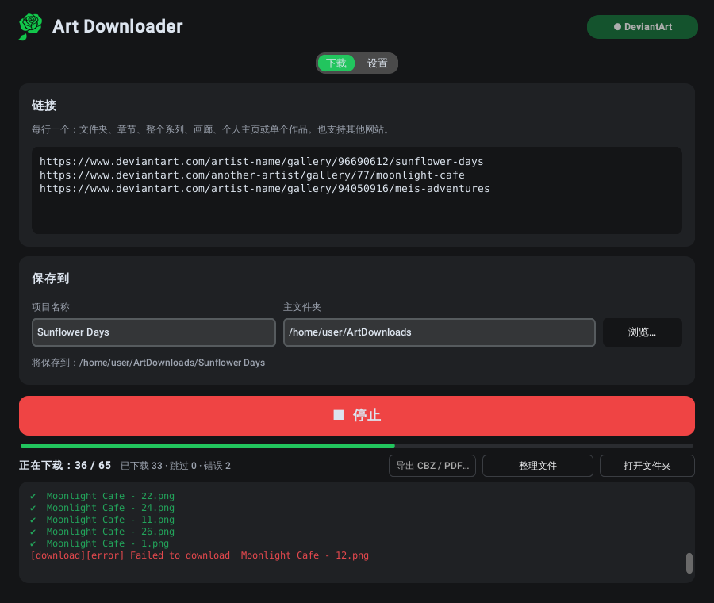

<p align="center"></p>

<h1 align="center">Art Downloader</h1>

<p align="center">
  <b>完整下载 DeviantArt 上的画廊和漫画——按阅读顺序排列，文件不会混乱。</b><br>
  Windows · Linux · 6 种语言
</p>

<p align="center">
  <a href="https://github.com/GreenClowns/Art-Downloader/releases/latest"><b>⬇ 下载</b></a> ·
  <a href="#使用方法">使用方法</a> ·
  <a href="#常见问题">常见问题</a>
</p>

<p align="center">
  <a href="README.md">English</a> · <a href="README.ru.md">Русский</a> · <a href="README.uk.md">Українська</a> · <a href="README.es.md">Español</a> · <a href="README.ja.md">日本語</a> · <b>中文</b>
</p>

<p align="center">
  
</p>

粘贴画廊、文件夹、章节或整个系列的链接，点击 **下载**，电脑上就会得到一个整理好的文件夹：每个章节一个文件夹，每页都按阅读顺序编号，多图投稿中的所有图片都会下载。18+ 作品可以通过你自己的 DeviantArt 账号下载。也支持 [gallery-dl](https://github.com/mikf/gallery-dl) 支持的其他网站。

## 下载

| 系统 | 文件 | 启动方式 |
|---|---|---|
| **Windows 10/11** | `ArtDownloader-…-Setup.exe` | 运行安装程序，然后从“开始”菜单打开 Art Downloader |
| Windows（免安装） | `ArtDownloader-…-portable.zip` | 解压到任意位置，运行 `ArtDownloader.exe` |
| **Linux**（Fedora、Ubuntu、Debian、Mint 等） | `ArtDownloader-…-x86_64.AppImage` | 首次允许执行，之后双击即可 |

所有文件都在 [**Releases**](https://github.com/GreenClowns/Art-Downloader/releases/latest) 页面。所需的一切都已包含在内——无需安装 Python，无需使用终端，也无需安装其他任何东西。

<details>
<summary><b>Windows：详细步骤</b></summary>

1. 下载 `ArtDownloader-…-Setup.exe` 并运行。不需要管理员权限。
2. 由于应用没有数字签名，Windows 可能会显示“Windows 已保护你的电脑”。点击 **更多信息 → 仍要运行**。
3. 从“开始”菜单打开 **Art Downloader**。

</details>

<details>
<summary><b>Linux：详细步骤</b></summary>

1. 下载 `ArtDownloader-…-x86_64.AppImage`，放到会长期保存的位置（例如主文件夹中的 `Apps` 文件夹）。
2. 允许执行（只需一次）：右键点击文件 → **属性** → 打开 **作为程序执行**（有些系统中为“允许作为程序执行文件”）。
3. 双击运行。首次启动时，应用会询问是否添加到应用程序菜单——选择 **是**。之后就能像其他应用一样启动（Super 键 →“Art”）。

如果之后移动了文件，从新位置启动一次，菜单项就会自动更新。

</details>

## 功能

**全部下载，并且有序**
- 文件夹、章节、带子文件夹的整个系列、画廊、个人主页或单个作品——只需粘贴链接。
- **投稿中的所有图片**：包含多张图片的 DeviantArt 投稿会完整下载，而不只是第一张。
- **阅读顺序**：网站上的每个文件夹都会成为一个本地文件夹，文件按 `001`、`002` … 编号。自动排序会使用标题中的数字（“Chapter 2 Cover”→“Chapter 2 - Page 1”→ …“Page 10”），因此即使作者乱序发布或之后重新上传，作品也会放到正确的位置。没有编号的作品按日期排序。也可以选择按日期、按画廊顺序或按标题。
- **不会混乱**：出现在多个链接中的作品会放进最具体的文件夹（它所属的章节，而不是作者的整个画廊）；包含多个章节的文件夹可以拆分为 `Chapter 01`、`Chapter 02` …

**可靠**
- **18+ 作品** 通过你自己的账号下载：只需点击一次 **连接 DeviantArt**（DeviantArt 官方的应用登录方式）。应用不会保存你的密码。
- 并行下载、失败文件自动重试、随时 **停止** 并继续——已下载的文件不会重复下载，编号也不会错乱。
- 作者之后发布的部分会在下次运行时插入到正确的位置：已有文件只会重新编号，不会重新下载。

**方便**
- **导出 CBZ / PDF…**：每个章节生成一本。CBZ 保留原始图片（适合漫画阅读器），PDF 在任何设备上都能打开。
- 窗口在后台时，下载完成会弹出 **桌面通知**。
- **更新**：每天检查一次；gallery-dl 一键即可更新（DeviantArt 改版后，旧版下载器可能无法使用）。
- 浅色和深色主题；English、Русский、Українська、Español、日本語 和 中文——主题和语言默认跟随系统。

下载结果：

```
ArtDownloads/Sunflower Days/
├── Chapter 1 - Sunflower/
│   ├── 001 - Sunflower Days - Chapter 1 - Cover.png
│   ├── 002 - Sunflower Days - Chapter 1 - Part 1.png
│   └── …
├── Chapter 2 - Sunflower/
│   ├── 004 - Sunflower Days - Chapter 2 - Part 3.png
│   ├── 005 - Sunflower Days - Chapter 2 - Part 4.png
│   ├── 005-02 - Sunflower Days - Chapter 2 - Part 4.png   ← 同一投稿的第 2 张图片
│   └── …
└── _Export/
    ├── Chapter 1 - Sunflower.cbz
    └── Chapter 2 - Sunflower.cbz
```

## 使用方法

1. 粘贴链接，每行一个：DeviantArt 的画廊、文件夹、章节、单个作品，或其他网站的链接。
2. 输入 **项目名称**：所有内容都会保存到 *主文件夹 / 项目名称*。
3. 下载 18+ 作品时，点击一次右上角的 **连接 DeviantArt**：浏览器会打开 DeviantArt——登录后点击 **Authorize**。
4. 点击 **⬇ 下载**。进度条显示“*k* / *N*”；可以随时点击 **停止**，之后再继续。
5. 可选：**导出 CBZ / PDF…** 生成书籍，**打开文件夹** 查看结果。

设置（第二个标签页）：登录方式、文件顺序、章节拆分、同时下载数、通知、更新、语言和主题。

## 常见问题

**下载 18+ 作品时出现 `403 Forbidden` 错误。**
点击 **连接 DeviantArt** 后重新下载。不连接的话，DeviantArt 只会给应用提供模糊版本。

**“连接 DeviantArt”一直无法完成。**
浏览器应该会打开 DeviantArt 页面：在那里登录并点击 **Authorize**，然后回到应用。如果浏览器没有打开，日志中会显示链接——请手动打开。

**有些作品没有下载。**
通常是付费内容（订阅、Premium Gallery）——只有你的账号有访问权限时才能下载。日志会列出这些文件，它们的编号会保留空缺，方便你看出缺少了什么。

**文件编号顺序不对。**
在 **设置 → 文件顺序** 中选择 **自动**（或 **按标题**），然后点击 **整理文件**：已下载的文件会重新编号，不会重新下载。

**Linux：双击 AppImage 没有反应。**
文件还没有被允许执行：右键 → 属性 → 打开 **作为程序执行**。仍然无法启动？请在终端中运行（`./ArtDownloader-…AppImage`），并附上输出内容提交 issue。

**Linux：移动文件后应用从菜单中消失了。**
从新位置启动一次，菜单项会自动更新。

**设置保存在哪里？**
Linux：`~/.config/art_downloader.json`。Windows：`%APPDATA%\ArtDownloader\settings.json`。密码永远不会被保存。详见 [SECURITY.md](SECURITY.md)。

## 卸载

- **Windows：** 设置 → 应用 → Art Downloader → 卸载。
- **Linux（AppImage）：** 在菜单中右键点击应用 → **从应用程序菜单中移除**，然后删除 `.AppImage` 文件。
- **Linux（源码安装）：** `bash install.sh uninstall`。

已下载的文件不会被删除。

## 安全与隐私

- 不保存密码；DeviantArt 访问使用官方登录方式，你可以随时撤销。
- 除了你下载的网站之外，应用每天只会访问一次 `pypi.org` 和 `api.github.com` 来检查更新（可以关闭）。
- 网站数据无法让应用写入下载文件夹以外的位置；应用不会覆盖其他文件，并会提醒可能运行程序的下载文件。
- 发布版本由 GitHub Actions 从本仓库构建，构建工具版本固定并经过校验和验证。

详情见 [SECURITY.md](SECURITY.md)。

## 开发者

整个应用就是一个文件 [`art_downloader.py`](art_downloader.py)——Python + [CustomTkinter](https://github.com/TomSchimansky/CustomTkinter)；下载由 [gallery-dl](https://github.com/mikf/gallery-dl) 完成。翻译位于同一文件中的 `TRANSLATIONS` 字典里。

```bash
git clone https://github.com/GreenClowns/Art-Downloader.git
cd Art-Downloader
pip install -r requirements.txt
python3 art_downloader.py      # 从源码运行
python3 -m pytest              # 测试，无需联网
```

发布新版本：**Releases → Draft a new release**，标签 `v1.2.3`，**Publish**——GitHub Actions 会自动构建并附上文件。仓库结构详见 [英文 README](README.md#for-developers)。

## 尊重创作者

Art Downloader 用于个人收藏。请不要未经许可重新发布他人的作品，并支持你喜欢的艺术家——关注他们、留言评论、购买他们的作品。

## 许可证

[MIT](LICENSE) © GreenClowns
